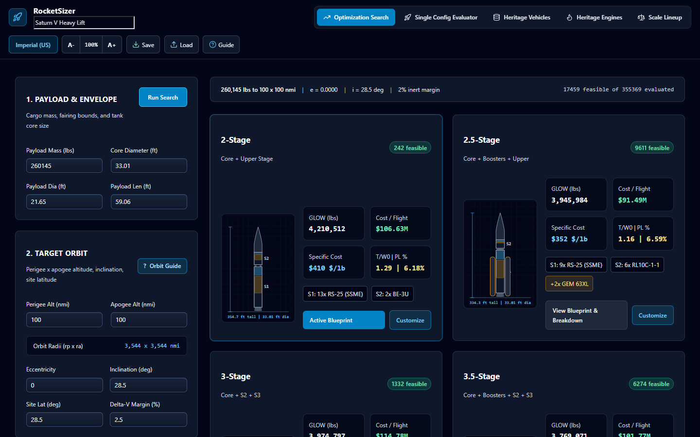
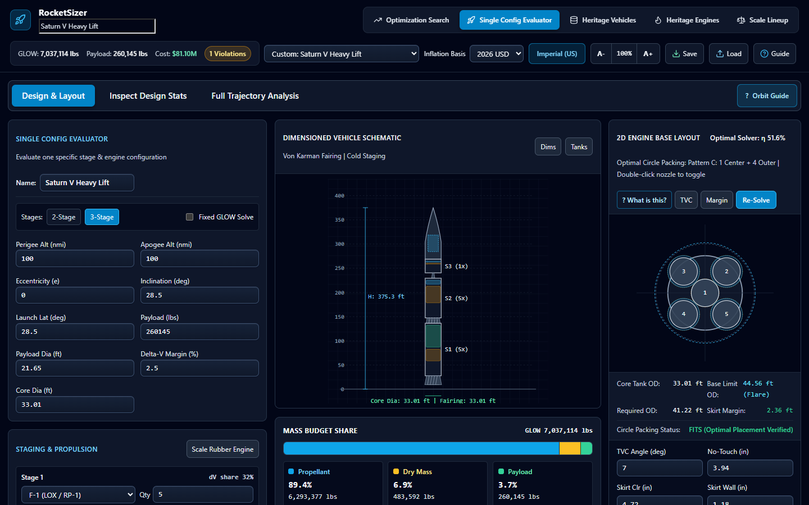

  

# RocketSizer

**Interactive launch vehicle sizing, structural mass estimation, nozzle layout, and cost trade studio.**

RocketSizer lets aerospace students and engineers compare 2-stage to 3.5-stage launch vehicles, sweep engine combinations against orbital delta-V budgets, explore 99 historical rockets and 132 engines with sourced citations, and export full design briefs offline.

---

## Download

| Platform | Download | Setup Guide |
| :--- | :--- | :--- |
| Windows | [RocketSizer-Windows.exe](https://github.com/DontKwo/RocketSizer/releases/latest/download/RocketSizer-Windows.exe) | [Windows Install Steps](docs/INSTALLATION.md#windows) |
| macOS | [RocketSizer-macOS.zip](https://github.com/DontKwo/RocketSizer/releases/latest/download/RocketSizer-macOS.zip) | [macOS Install Steps](docs/INSTALLATION.md#macos) |
| Linux | [RocketSizer-Linux.tar.gz](https://github.com/DontKwo/RocketSizer/releases/latest/download/RocketSizer-Linux.tar.gz) | [Linux Install Steps](docs/INSTALLATION.md#linux) |

---

## Screenshots

  

  

---

## How to Use

1. Download the executable for your platform from the table above.
2. Follow the [Desktop Installation Guide](docs/INSTALLATION.md) if Windows SmartScreen or macOS Gatekeeper prompts for approval.
3. Choose an orbit preset and payload mass in **Optimization Search**, click **Run Search**, and compare feasible rocket architectures.
4. Open any candidate in **Single Config Evaluator** to inspect dimensioned schematics, base engine packing, structural breakdowns, and exported briefs.

---

## Key Features

- **Combinatorial Stage Optimizer**: Evaluates 2-stage through 3.5-stage vehicles with booster reuse, MGA margin, and 2-DOF gravity-turn delta-V closure.
- **Interactive Base Engine Packing**: Visualizes 2D nozzle circles, TVC gimbal envelopes, and stage skirt clearances with drag-and-drop editing.
- **Cited Heritage Database**: Includes 99 historical launch vehicles and 132 engines with click-to-inspect reference sources and model validation benchmarks.

---

## Documentation

### User Documentation
- [User Guide](docs/USER_GUIDE.md)
- [Desktop Installation Guide](docs/INSTALLATION.md)
- [Frequently Asked Questions](docs/FAQ.md)

### Developer Documentation
- [Developer Guide](docs/DEVELOPMENT.md)
- [Developer uv Installation](docs/UV_INSTALLATION.md)

### Mathematical Models, Validation & AI Documentation
- [System Architecture](docs/ARCHITECTURE.md)
- [Mathematical Models](docs/MATHEMATICAL_MODELS.md)
- [Cost Model Reference](docs/COST_MODEL_REFERENCE.md)
- [Model Validation Benchmarks](docs/MODEL_VALIDATION.md)
- [Provenance Guide](docs/PROVENANCE_GUIDE.md)
- [AI Agent Reference](AGENTS.md)

### Legal & Security Policies
- [Security Policy](SECURITY.md)
- [Third-Party Notices](THIRD_PARTY_NOTICES.md)
- [MIT License](LICENSE)

---

## Safety & Disclaimers

- **Official `main` Releases Only**: Download executables exclusively from [DontKwo/RocketSizer Releases](https://github.com/DontKwo/RocketSizer/releases/latest) (`main` branch). Never run forked builds unless you are sure they contain no malware; only official `main` releases are maintained by the author, and I make no promises.
- **OS Security Warnings**: Windows SmartScreen and macOS Gatekeeper will likely warn that independently built executables are unrecognized or unsafe. Bypassing prompts is strictly at your own discretion using [Desktop Installation Guide](docs/INSTALLATION.md).
- **Conceptual Engineering & AS-IS Disclaimer**: Outputs are educational conceptual estimates, **not** certified aerospace flight hardware or structural qualification guarantees. Provided "AS IS" under the [MIT License](LICENSE) with zero warranty or liability at your own risk.
